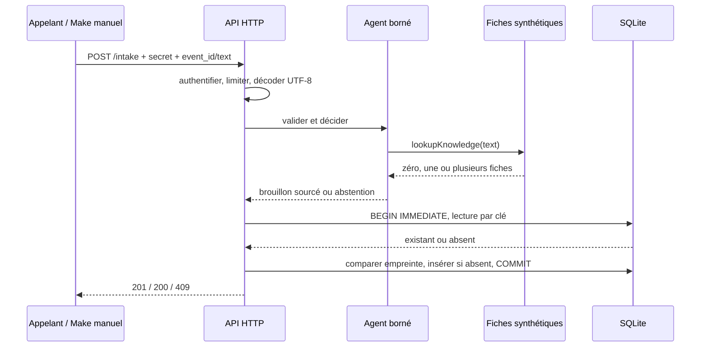

# Architecture et décision : monolithe modulaire

Statut : implémenté. Un processus Node porte trois responsabilités distinctes : transport HTTP (`server.mjs`), décision sans accès réseau (`agents/support/agent.mjs`), transaction (`automations/intake/store.mjs`). Aucun microservice, bus ou moteur vectoriel n'est nécessaire pour deux catégories et un effet local.



L'appel à l'agent est en réalité encapsulé dans `store.accept`, avant l'ouverture de transaction. Il est pur et sans effet externe : le rejouer avant lecture ne coûte aucun appel modèle. Pour un futur LLM coûteux, déplacer la recherche du cache et formaliser un état de traitement avant l'appel.

## Outils et contrôle

La politique fixe la liste de fiches et les transitions `validate → lookup_knowledge → route → draft_for_human`. Un sujet inconnu ou ambigu produit `draft=null`; un texte sensible peut être arrêté avant recherche. Les identifiants KB renvoient aux fiches de démonstration dans le code, pas à des règles de support d'une entreprise réelle. La garde lexicale sur prompt/secret est conservatrice et contournable; la vraie frontière est l'absence d'exécution de commandes et d'outils externes. Aucun score de confiance n'est inventé.

## Base et transaction

```sql
CREATE TABLE tickets (
  event_id TEXT PRIMARY KEY,
  fingerprint TEXT NOT NULL,
  result TEXT NOT NULL
) STRICT;
PRAGMA user_version=1;
```

Version 1 initialisée au démarrage avec `CREATE TABLE IF NOT EXISTS`; ce n'est pas un moteur de migrations générales. L'identifiant de l'événement est une clé métier fournie par l'appelant. L'empreinte SHA-256 porte sur le texte exact, sans normaliser espaces ou accents : une variation retourne volontairement un conflit. Le texte brut n'est pas stocké; l'empreinte reste potentiellement sensible et ne constitue pas une anonymisation. Le résultat stocke uniquement brouillon fixe, catégories et trace.

`BEGIN IMMEDIATE` sérialise lecture et insertion; clé primaire et paramètres SQL empêchent doublon et injection. Une exception déclenche ROLLBACK. Une panne après COMMIT mais avant réponse est récupérable par rejouer la même clé. La déduplication concerne l'enregistrement dans cette base seulement, pas un futur email ou une écriture CRM. Pour ces effets, il faudrait une outbox et un consommateur lui-même idempotent.

## Alternatives et seuil de changement

| Choix | Alternative | Pourquoi / quand changer |
|---|---|---|
| Règles et fiches fixes | LLM + recherche documentaire | Baseline sans coût modèle, sorties reproductibles; LLM si paraphrases réelles mal couvertes et corpus évalué |
| SQLite, mono-instance | PostgreSQL | Déploiement local simple et transaction atomique; PostgreSQL si plusieurs réplicas ou stockage éphémère |
| Modules locaux | Services séparés | Moins de réseau et de pannes; séparer si équipes, contraintes ou charges distinctes mesurées |
| Brouillon humain | Réponse automatique | Risque limité; automatiser seulement après évaluation, autorisation et contrôles métier |

Compromis : SQLite synchrone bloque brièvement la boucle Node; attente de verrou bornée à 3 secondes, pas de benchmark de charge. Le stockage grandit sans purge. Aucun coût de service supplémentaire local, hors machine/énergie. Pas d'achat ou d'infrastructure provisionnée.
